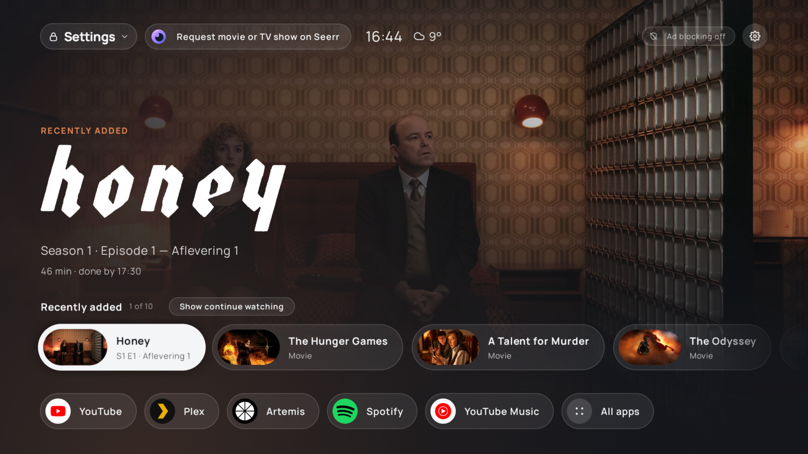
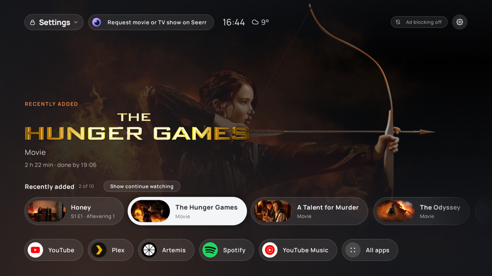

# Veil

**A calm, private home screen for Android TV.** Veil replaces your TV's home screen with a clean, cinematic
one: big artwork, what you're watching, your apps, and nothing else. No ads, no "recommended for you",
no tracking.



| | |
|---|---|
|  |  |
|  |  |
|  |  |
|  |  |

More in [`screenshots/`](screenshots).

> **This is a modified version** of [Veil](https://github.com/trbrnt/Veil) (GPL-3.0), with these additions:
> - **Plex** as a source (Connect a tracker → Plex, then enter the code at plex.tv/link): **Continue watching**
>   and a switchable **Recently added** row straight from your own Plex server(s). Artwork comes from TMDB,
>   with the server's own artwork as the fallback. OK starts the title in the Plex app, after a start-up
>   wait you can tune in the Veil menu (*Plex → Wait before playing*); the hold menu marks it watched or
>   removes it from Continue Watching on the server.
> - A **Request** screen for your own **Seerr** (Overseerr / Jellyseerr) server, opened from the button next
>   to the *veil* button: search or browse trending; filter by **Movies / TV shows**, **Popular / Latest**,
>   **streaming service** (for example *the latest movies on Netflix*) and **In my library**; 36 titles at a
>   time with a **More** button; IMDb and Rotten Tomatoes scores on the posters; a details window with
>   description, genres, release date, cast and more; and on its right side the actions: request a movie,
>   a whole show, **specific seasons** or all missing seasons, or **Play on Plex** for what you already own.
> - **Double press of Home** opens the TV's recent-apps screen, where running apps can be switched to or
>   closed (experimental; a single press now waits about a third of a second to tell the two apart).
> - Home-network server names (like your Seerr's) keep working while ad blocking's DNS is on: the name is
>   asked from your router and the connection is still verified against the real host name.
>
> Settings for the additions: `SEERR_URL` and `SEERR_API_KEY` in `source/keys.properties` (see below).
> Plex needs no key.

> **Installing:** Veil is built from source with *your own* API keys. The easiest way is to give this repo
> to an AI coding agent (for example Claude Code) and ask it to follow
> **[`AGENT_INSTALL.md`](AGENT_INSTALL.md)**. It checks your TV, asks for your keys, backs up your settings,
> and confirms before it changes anything.

## What you get

- **Home**: full-screen artwork of the show or film you're on, with its title logo and a slow pan and zoom.
  The accent colour follows the artwork. Rows for **Continue watching** (from your **Trakt**, **Simkl** or
  **MDBList** account, your pick; opens the episode in **Nuvio** or **Stremio**, ready to stream) or from your
  own **Plex** server (with a switch to **Recently added**), and your **apps** (pin and reorder them). Clock
  and weather at the top, and a **Request** button next to the *veil* button.
- **Request** (needs your own Seerr server): search or browse, filter by movies / shows, popular / latest,
  streaming service and what's already in your library, see IMDb and Rotten Tomatoes scores and a full
  details window, then request a movie, a show or just the seasons you want, or play it on Plex if you
  already have it.
- **Privacy pill**: one switch for system-wide ad and tracker blocking via encrypted DNS (NextDNS if you
  have it, otherwise AdGuard DNS), with "pause for 15 minutes / 1 hour" for sites that break. With NextDNS
  it also shows how many trackers it blocked.
- **Veil Ambient** (screensaver): a slow slideshow of artwork. While music plays (Spotify etc.) it shows
  the album art with **synced lyrics** (word by word when available), or a full-screen **music visualizer**
  that picks out the kick, snare, hi-hats and vocals, locks onto the tempo and pulses on the beat.
- **Themes**, colours taken from the artwork, glassy cards that catch the light, soft UI sounds, seasonal
  touches (snow in December) and a wake-up intro when the TV turns on.
- **Made for weak TV hardware**: everything heavy is pre-rendered, and it was profiled on a real device.

## Requirements

- An Android TV or Google TV, **Android 9 or newer**, controllable over ADB (developer options).
- A computer (Windows, macOS or Linux) with JDK 17 and the Android SDK command-line tools. Gradle comes
  with the repo (`source/gradlew`).
- **Your own free API keys** (the repo contains none, apart from Veil's shared tracker apps):

| Key | Needed for | Where |
|---|---|---|
| TMDB API key | Artwork and title logos (**required**) | themoviedb.org → Settings → API |
| Trakt / Simkl / MDBList client ID | Not needed: Veil's shared apps are built in. Optional, to use your own | trakt.tv/oauth/applications, simkl.com/settings/developer, mdblist.com/developer |
| NextDNS profile + API key | NextDNS blocking and the blocked counter (optional) | my.nextdns.io |
| Seerr address + API key | The Request screen (optional; hidden when empty) | your Seerr: Settings → General |

Keys go in `source/keys.properties` (copy `keys.properties.example`), which git ignores. Continue
Watching works out of the box through Veil's shared tracker apps (`source/trakt.properties`,
`simkl.properties` and `mdblist.properties`, public on purpose: TV sign-in apps have no secret). Your
*account* is never put into the app: on the **Connect** screen you pick Trakt, Simkl or MDBList and sign in
on your phone by scanning a QR code (or typing a short code), like any TV app. One tracker is connected at a
time. To use your own Trakt app instead, pick **Use your own Trakt app** on the Connect Trakt screen and
enter its Client ID with the remote, or set `TRAKT_CLIENT_ID` in `keys.properties` (likewise
`SIMKL_CLIENT_ID` / `MDBLIST_CLIENT_ID`).

**Plex** needs no key: pick it on the Connect screen and type the 4-character code at plex.tv/link. The Plex
app has to be installed on the TV to play anything.

Continue watching from Trakt, Simkl or MDBList opens in **Nuvio** when it's installed, otherwise in
**Stremio** (there is no setting for it). Both open the exact episode, ready to pick a stream.

## Permissions, and why

A TV can't ask for these with a pop-up, so they're granted over ADB (the install guide explains each one first).

| Permission | What it's used for | What it does **not** do |
|---|---|---|
| Home screen + Home-button helper (accessibility service) | Makes the remote's Home button open Veil (two quick presses open the TV's recent apps) | Sees only the Home key and which app is in front. It can't read the screen or other keys |
| Notification access | Reads "now playing" (song, artist, cover) from media apps | Ignores the contents of your notifications |
| Audio (RECORD_AUDIO) | The visualizer reads the TV's **output** loudness live | No microphone. Nothing is recorded, stored or sent |
| Secure settings (WRITE_SECURE_SETTINGS) | Turns the Private DNS blocking on and off; keeps the Home helper enabled | Nothing else |
| Internet | The services below | - |

## Privacy

- **No accounts, analytics, ads or Veil servers.** Veil talks directly to these services over HTTPS:
  - **TMDB**: titles of what you're watching, to get artwork (and the posters on the Request screen).
  - **Trakt, Simkl or MDBList** (only the one you connect): reads your watch progress with your own login
    and, only when you ask, marks items watched or removes them from Continue Watching (clears paused
    progress; for shows, Trakt hides it from progress, Simkl moves it to "On hold", MDBList marks it
    dropped, all undoable on the service). Simkl and MDBList are only asked again when their "last
    activity" changed, to stay well within their limits.
  - **Open-Meteo**: your chosen city, for the weather.
  - **LRCLIB**: the song currently playing (title, artist, album, length), to get lyrics.
  - **NextDNS API**: your blocked-tracker stats, if set up.
  - **Plex** (only if you pick it): plex.tv to sign in and list your servers, then your own Plex Media
    Server(s) for Continue watching, Recently added, artwork, and the mark-watched / remove actions. Veil
    only talks to servers over HTTPS.
  - **Seerr** (only if you set `SEERR_URL`): your own Seerr server, for searching, browsing, details, scores
    and requests. Seerr itself looks up the IMDb and Rotten Tomatoes scores. If its address only exists on
    your home network and ad blocking's outside DNS can't find it, Veil asks your router's DNS for that one
    name and connects there, still checking the certificate against the real host name.
  - **GitHub**: once a day, asks for the date of the latest code change in `Jaarden/Veil-Custom`, to show "update available"
    in the Veil menu. Nothing about you is sent. Switch it off in the Veil menu, or with
    `UPDATE_CHECK=false` in `keys.properties`.
- **Your tracker login** stays on the TV, in Veil's private storage (excluded from Android backups).
  Switching to another tracker signs Veil out of the old one. Your Plex sign-in is kept the same way, and
  the Seerr API key is compiled into the app from `keys.properties` (which git ignores).
- **DNS blocking is off until you turn it on.** It uses Android's built-in Private DNS, so it covers every
  app on the TV, and it can be paused or switched off at any time.

## Updating

When a newer Veil is out, a small dot appears on the "veil" button and the Veil menu says **Update
available**. Ask your AI agent to update Veil: it follows the *Updating Veil* section of
[`AGENT_INSTALL.md`](AGENT_INSTALL.md) (pull, rebuild on the same computer, install over the old one). Your
permissions, sign-in and settings stay as they are.

The *Update available* dot follows this repository (`Jaarden/Veil-Custom`). If you fork it again, change
`REPO` in `source/app/src/main/java/dev/veil/launcher/data/UpdateCheck.kt`.

## Undo

The install guide has the agent save your TV's current settings and write an **undo script** for your TV
first. Running it brings back your original home screen, screensaver, DNS and permissions. Veil itself can
then be removed with `adb uninstall dev.veil.launcher`. Nothing on the TV's system is removed or modified.

## Building

```sh
cd source
cp keys.properties.example keys.properties   # then fill in your keys
./gradlew assembleRelease                    # → app/build/outputs/apk/release/app-release.apk
```
See [`AGENT_INSTALL.md`](AGENT_INSTALL.md) for installing, permissions and performance notes.

## Credits

- Built with [Claude Code](https://claude.com/claude-code). Kotlin + Jetpack Compose for TV.
- Artwork and logos from [TMDB](https://www.themoviedb.org). *This product uses the TMDB API but is not
  endorsed or certified by TMDB.*
- Watch progress from [Trakt](https://trakt.tv), [Simkl](https://simkl.com) or [MDBList](https://mdblist.com).
  *Veil uses Trakt but is not endorsed or certified by Trakt.* The three services' app icons are shown on
  the Connect screen only to identify them.
- Lyrics from [LRCLIB](https://lrclib.net), weather from [Open-Meteo](https://open-meteo.com) (CC BY 4.0).
- [Manrope](https://github.com/sharanda/manrope) font, under the SIL Open Font License 1.1
  ([`licenses/OFL-Manrope.txt`](licenses/OFL-Manrope.txt)).
- NextDNS, Trakt, Simkl, MDBList, TMDB, Plex, Seerr, Spotify, Nuvio and Stremio are trademarks of their owners. Veil isn't affiliated with any of them. The Plex and Seerr icons are shown only to identify the services.

## License

[GPL-3.0](LICENSE). You're free to use, change and share Veil. If you share a modified version, it has to
be open source under the same license.
